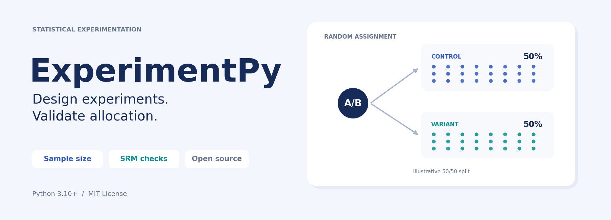
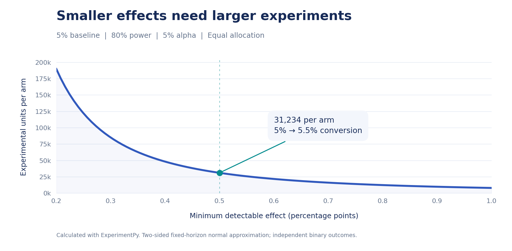

[](https://pypi.org/project/experimentpy/)
[](https://pypi.org/project/experimentpy/)
[](https://github.com/UbaldoHervas/experimentation-library/blob/main/LICENSE)
[](https://pypi.org/project/experimentpy/)

**[Documentation](https://github.com/UbaldoHervas/experimentation-library/blob/main/docs/README.md) · [Source code](https://github.com/UbaldoHervas/experimentation-library) · [Issues](https://github.com/UbaldoHervas/experimentation-library/issues) · [Changelog](https://github.com/UbaldoHervas/experimentation-library/blob/main/CHANGELOG.md)**

# ExperimentPy

Statistical tools for online experimentation in Python. Plan the sample size
of a binary A/B metric and check whether the observed allocation matches the
experiment design, with explicit assumptions and structured results.

## What you can do

| Task | Function | Result |
| --- | --- | --- |
| Plan an A/B test | `sample_size_proportions()` | Required sample size for control and variant, given a baseline, MDE, power and allocation ratio. |
| Check sample ratio mismatch | `check_srm()` | Chi-square statistic, p-value and SRM flag for two or more variants. |

## Installation

```bash
pip install experimentpy
```

Requires **Python 3.10+**. SciPy is the only direct runtime dependency.
The GitHub repository is named `experimentation-library`; the current package
and import name are `experimentpy`.

## Plan your experiment

How many independent experimental units do you need to detect a change from
**5% to 5.5%** conversion?

```python
from experimentpy import sample_size_proportions

plan = sample_size_proportions(
    baseline=0.05,
    mde_absolute=0.005,
    alpha=0.05,
    power=0.80,
    ratio=1.0,
)

print(f"Control: {plan.n_control:,}")
print(f"Variant: {plan.n_variant:,}")
print(f"Total:   {plan.total:,}")
```

```text
Control: 31,234
Variant: 31,234
Total:   62,468
```

`mde_absolute=0.005` means **0.5 percentage points**: a **10% relative lift**
on a 5% baseline. Use `baseline * relative_lift` to express a relative MDE.



The curve is calculated with the library's sample-size function. Smaller
effects require larger samples. This is a two-sided, fixed-horizon normal
approximation for independent binary outcomes.

## Validate your allocation

Check the number of independent randomized units assigned to each arm:

```python
from experimentpy import check_srm

quality = check_srm(
    observed={"control": 5100, "variant": 4900},
    allocation={"control": 0.5, "variant": 0.5},
    alpha=0.001,
)

print(f"SRM p-value: {quality.pvalue:.4f}")
print(f"SRM detected: {quality.has_srm}")
```

```text
SRM p-value: 0.0455
SRM detected: False
```

The default SRM threshold is **0.001**, separate from the alpha used to plan
an outcome analysis. A nonsignificant SRM result does not establish that the
experiment is valid in every other respect.

## Documentation

- **[Quickstart](https://github.com/UbaldoHervas/experimentation-library/blob/main/docs/quickstart.md)** — equal and unequal allocations, positive and negative MDEs, and exporting results.
- **[API reference](https://github.com/UbaldoHervas/experimentation-library/blob/main/docs/api.md)** — parameters, result fields and input validation.
- **[Statistical methods](https://github.com/UbaldoHervas/experimentation-library/blob/main/docs/methodology.md)** — formulas, assumptions and the boundaries of each method.

## Current scope and roadmap

The current release implements **sample-size planning and SRM checks**.
Sample-size planning assumes independent Bernoulli outcomes, a fixed horizon
and one planned comparison. SRM checks use assignment counts before
post-treatment filtering.

Planned extensions include effect estimation and confidence intervals,
outcome hypothesis tests, practical significance, variance reduction and
quasi-experimental methods. These are not implemented in the current API.

## Development

```bash
git clone https://github.com/UbaldoHervas/experimentation-library.git
cd experimentation-library
python -m pip install -e ".[dev]"
python -m unittest discover -s tests -v
```

The test suite includes numerical reference checks, input validation and
independent binomial simulations of the sample-size design.

## License and author

[MIT License](https://github.com/UbaldoHervas/experimentation-library/blob/main/LICENSE).
Copyright (c) 2026 **Ubaldo Hervas**.
